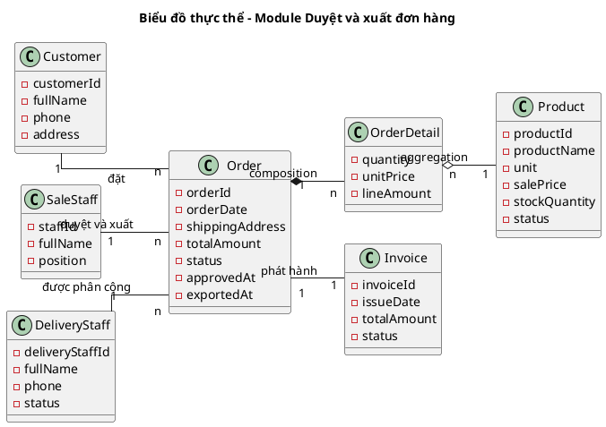
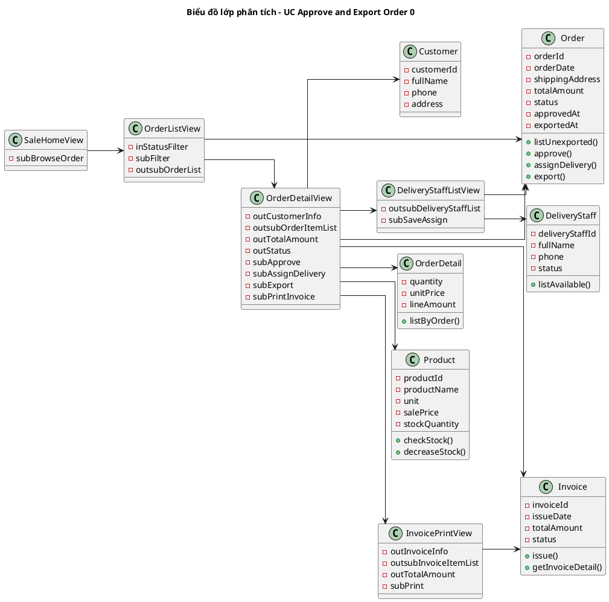
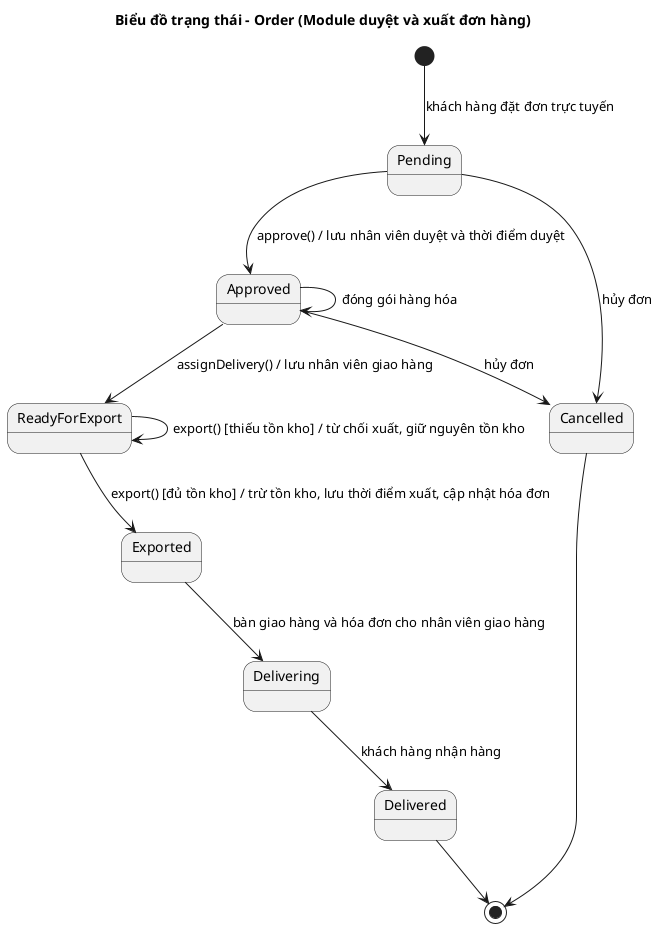
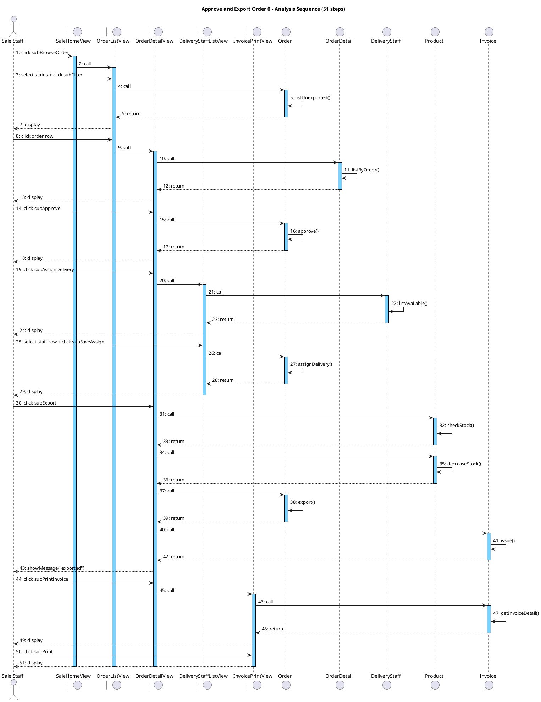

# Đặc tả use case: Approve and Export Order 0 (UC-SALE-01)

> Module 2 – Sale staff approves orders + export.
> Hệ thống: Online Department Store Management System (B23DCAT280).
> Phân rã: Browse Orders 0, View Order Detail 0, Approve Order 0, Pack Order 0, Assign Delivery Staff 0, Export Order 0, Print Invoice 0.

## 1. Kịch bản chuẩn

| Trường | Nội dung |
|---|---|
| **Use case** | Approve and Export Order 0 (Duyệt đơn và xuất hàng) |
| **Actor** | Sale Staff (Nhân viên bán hàng) |
| **Tiền điều kiện** | Nhân viên bán hàng đã đăng nhập thành công; tồn tại ít nhất một đơn hàng chưa xuất, chưa bị hủy |
| **Hậu điều kiện** | Đơn hàng chuyển sang trạng thái "Đã xuất"; tồn kho của từng sản phẩm trong đơn giảm đúng số lượng đặt; đơn được gán nhân viên giao hàng, lưu nhân viên xử lý và thời điểm xuất; hóa đơn tương ứng được cập nhật và đã in để giao kèm hàng hóa |
| **Kịch bản chính** | 1. Nhân viên bán hàng chọn chức năng "Duyệt và xuất đơn hàng" từ giao diện chính. 2. Hệ thống hiển thị giao diện "Danh sách đơn hàng" có: ô chọn trạng thái, nút Lọc và vùng hiển thị danh sách đơn. 3. Nhân viên bán hàng chọn trạng thái "Chưa xuất" và nhấn nút "Lọc". 4. Hệ thống hiển thị danh sách các đơn chưa xuất: <table><tr><th>Mã đơn</th><th>Khách hàng</th><th>Ngày đặt</th><th>Số mặt hàng</th><th>Tổng tiền</th><th>Trạng thái</th></tr><tr><td>DH1024</td><td>Nguyễn Văn An</td><td>05/09/2026</td><td>3</td><td>1.250.000</td><td>Chờ duyệt</td></tr><tr><td>DH1025</td><td>Trần Thị Bích</td><td>05/09/2026</td><td>1</td><td>320.000</td><td>Chờ duyệt</td></tr><tr><td>DH1026</td><td>Lê Minh Cường</td><td>06/09/2026</td><td>2</td><td>780.000</td><td>Đã duyệt</td></tr></table> 5. Nhân viên bán hàng chọn dòng số 1 (mã đơn = DH1024, khách hàng = Nguyễn Văn An). 6. Hệ thống hiển thị giao diện chi tiết đơn hàng DH1024 với thông tin khách hàng (Nguyễn Văn An – 0905112233 – 25 Trần Duy Hưng, Cầu Giấy, Hà Nội), trạng thái "Chờ duyệt", nút "Duyệt đơn", nút "Quay lại" và danh sách sản phẩm: <table><tr><th>Mã SP</th><th>Tên sản phẩm</th><th>Đơn vị</th><th>Số lượng</th><th>Đơn giá</th><th>Thành tiền</th><th>Tồn kho</th></tr><tr><td>SP07</td><td>Gạo ST25 5kg</td><td>Túi</td><td>2</td><td>250.000</td><td>500.000</td><td>40</td></tr><tr><td>SP15</td><td>Dầu ăn Neptune 1L</td><td>Chai</td><td>5</td><td>60.000</td><td>300.000</td><td>120</td></tr><tr><td>SP22</td><td>Sữa tươi Vinamilk 1L</td><td>Hộp</td><td>10</td><td>45.000</td><td>450.000</td><td>60</td></tr></table>Tổng tiền: 1.250.000 7. Nhân viên bán hàng kiểm tra thông tin đơn và nhấn nút "Duyệt đơn". 8. Hệ thống kiểm tra đơn DH1024 hợp lệ: đơn chưa bị hủy và chưa được xuất. 9. Hệ thống ghi nhận đơn DH1024 do nhân viên bán hàng hiện tại duyệt, chuyển trạng thái đơn thành "Đã duyệt" và hiển thị thêm nút "Chọn nhân viên giao hàng". 10. Nhân viên bán hàng chuẩn bị và đóng gói hàng hóa đúng theo danh sách sản phẩm và số lượng của đơn DH1024 (hoạt động thực tế ngoài phần mềm). 11. Nhân viên bán hàng nhấn nút "Chọn nhân viên giao hàng". 12. Hệ thống hiển thị danh sách nhân viên giao hàng: <table><tr><th>Mã NV</th><th>Họ tên</th><th>Số điện thoại</th><th>Khu vực</th><th>Số đơn đang giao</th><th>Trạng thái</th></tr><tr><td>GH03</td><td>Phạm Văn Dũng</td><td>0912345678</td><td>Cầu Giấy</td><td>1</td><td>Sẵn sàng</td></tr><tr><td>GH05</td><td>Ngô Thị Hà</td><td>0987654321</td><td>Đống Đa</td><td>0</td><td>Sẵn sàng</td></tr><tr><td>GH08</td><td>Đỗ Quang Huy</td><td>0933221100</td><td>Hà Đông</td><td>3</td><td>Đang giao</td></tr></table> 13. Nhân viên bán hàng chọn dòng số 1 (mã = GH03, tên = Phạm Văn Dũng) và nhấn nút "Lưu phân công". 14. Hệ thống lưu nhân viên giao hàng GH03 cho đơn DH1024, hiển thị lại chi tiết đơn kèm nút "Xác nhận xuất hàng". 15. Nhân viên bán hàng nhấn nút "Xác nhận xuất hàng". 16. Hệ thống kiểm tra đơn DH1024 chưa từng được xuất, đã có nhân viên giao hàng và mọi sản phẩm trong đơn còn đủ số lượng trong kho. 17. Hệ thống trừ tồn kho từng sản phẩm: SP07 còn 38, SP15 còn 115, SP22 còn 50. 18. Hệ thống chuyển trạng thái đơn DH1024 thành "Đã xuất", lưu nhân viên bán hàng xử lý, thời điểm xuất 06/09/2026 09:15 và nhân viên giao hàng GH03; cập nhật hóa đơn tương ứng. 19. Hệ thống thông báo "Xuất hàng thành công cho đơn DH1024" và hiển thị nút "In hóa đơn". 20. Nhân viên bán hàng nhấn nút "In hóa đơn". 21. Hệ thống hiển thị bản xem trước hóa đơn HD1024 (khách hàng Nguyễn Văn An, ngày lập 06/09/2026, địa chỉ nhận 25 Trần Duy Hưng, Cầu Giấy, Hà Nội) kèm nút "In": <table><tr><th>Mã SP</th><th>Tên sản phẩm</th><th>Số lượng</th><th>Đơn giá</th><th>Thành tiền</th></tr><tr><td>SP07</td><td>Gạo ST25 5kg</td><td>2</td><td>250.000</td><td>500.000</td></tr><tr><td>SP15</td><td>Dầu ăn Neptune 1L</td><td>5</td><td>60.000</td><td>300.000</td></tr><tr><td>SP22</td><td>Sữa tươi Vinamilk 1L</td><td>10</td><td>45.000</td><td>450.000</td></tr><tr><td colspan="4">Tổng tiền hóa đơn</td><td>1.250.000</td></tr></table> 22. Nhân viên bán hàng nhấn nút "In" và nhận bản in hóa đơn HD1024. 23. Nhân viên bán hàng bàn giao kiện hàng đã đóng gói cùng hóa đơn HD1024 cho nhân viên giao hàng Phạm Văn Dũng (GH03) — hoạt động thực tế ngoài phần mềm. 24. Hệ thống quay về danh sách đơn chưa xuất; đơn DH1024 không còn xuất hiện trong danh sách. |
| **Ngoại lệ** | 8. Đơn hàng đã bị hủy. 8.1 Hệ thống hiển thị thông báo "Đơn hàng DH1024 đã bị hủy, không thể duyệt". 8.2 Nhân viên bán hàng nhấn OK và quay về danh sách đơn chưa xuất (Bước 4).  16a. Đơn hàng đã được nhân viên bán hàng khác xuất trước đó. 16a.1 Hệ thống hiển thị thông báo "Đơn hàng DH1024 đã được xuất, không thể xuất lần thứ hai". 16a.2 Hệ thống hiển thị trạng thái mới nhất của đơn và không thay đổi tồn kho. 16a.3 Nhân viên bán hàng nhấn OK và quay về danh sách đơn chưa xuất (Bước 4).  16b. Một hoặc nhiều sản phẩm không đủ tồn kho. 16b.1 Hệ thống hiển thị thông báo "Không đủ hàng để xuất đơn DH1024" kèm danh sách sản phẩm thiếu (SP22 – Sữa tươi Vinamilk 1L: cần 10, còn 4). 16b.2 Hệ thống giữ nguyên tồn kho của mọi sản phẩm và giữ trạng thái đơn ở "Đã duyệt". 16b.3 Nhân viên bán hàng nhấn OK và quay về chi tiết đơn (Bước 14) để xử lý lại sau khi kho được bổ sung.  16c. Chưa chọn nhân viên giao hàng. 16c.1 Hệ thống hiển thị thông báo "Vui lòng chọn nhân viên giao hàng trước khi xuất đơn". 16c.2 Nhân viên bán hàng nhấn OK và thực hiện lại việc phân công (quay về Bước 11).  22. Lỗi trong quá trình in hóa đơn. 22.1 Hệ thống thông báo "In hóa đơn không thành công". 22.2 Hệ thống giữ nguyên đơn DH1024 ở trạng thái "Đã xuất" và không hoàn lại tồn kho. 22.3 Nhân viên bán hàng nhấn nút "In hóa đơn" để thực hiện lại (quay về Bước 20). |

## 2. Ghi chú kịch bản

- **Bước 10 và Bước 23** là hoạt động nghiệp vụ thực tế bên ngoài phần mềm, được giữ trong kịch bản vì đề bài yêu cầu ("đóng gói", "giao hàng hóa và hóa đơn cho nhân viên giao hàng").
- **Số liệu nhất quán:** đơn DH1024 xuất hiện ở Bước 4 → 5 → 6 → 9 → 14 → 18 → 19; tồn kho ở Bước 6 (40 / 120 / 60) trừ đúng số lượng đặt (2 / 5 / 10) cho kết quả Bước 17 (38 / 115 / 50); tổng tiền 1.250.000 giữ nguyên từ Bước 4 đến hóa đơn HD1024.
- **Quy tắc nghiệp vụ liên quan:** BR02 (chỉ Sale Staff duyệt/xuất đơn), BR03 (mỗi đơn chỉ xuất một lần — ngoại lệ 16a), BR04 (đủ tồn kho mới được xuất — ngoại lệ 16b), BR05 (giảm tồn kho và đổi trạng thái đơn cùng một lần, không cập nhật nửa vời), BR06 (phải phân công nhân viên giao hàng trước khi xuất — ngoại lệ 16c), BR07 (trạng thái đi theo thứ tự Chờ duyệt → Đã duyệt → Đã xuất).
- **Trạng thái đơn theo kịch bản:** Chờ duyệt (Bước 4) → Đã duyệt (Bước 9) → Đã xuất (Bước 18).

---

## 3. Mô hình hóa lớp (trích lớp thực thể)

### 3.1. Bước 1 – Mô tả chức năng bằng văn xuôi

Nhân viên bán hàng đăng nhập vào hệ thống rồi chọn chức năng duyệt và xuất đơn hàng. Hệ thống hiển thị danh sách các đơn đặt hàng chưa xuất, mỗi đơn hàng gồm mã đơn, khách hàng đã đặt đơn, ngày đặt, địa chỉ nhận hàng, tổng tiền và trạng thái. Nhân viên bán hàng chọn một đơn hàng để xem chi tiết. Hệ thống hiển thị thông tin khách hàng và các dòng chi tiết đơn hàng, mỗi dòng gồm sản phẩm, số lượng đặt, đơn giá tại thời điểm đặt và thành tiền, kèm số lượng tồn kho hiện tại của sản phẩm. Nhân viên bán hàng kiểm tra đơn và duyệt đơn; hệ thống lưu lại nhân viên bán hàng đã duyệt, thời điểm duyệt và chuyển trạng thái đơn thành đã duyệt. Nhân viên bán hàng đóng gói hàng hóa theo các dòng chi tiết đơn hàng rồi chọn nhân viên giao hàng trong danh sách nhân viên giao hàng đang sẵn sàng; hệ thống lưu nhân viên giao hàng cho đơn. Nhân viên bán hàng xác nhận xuất hàng; hệ thống kiểm tra đơn chưa từng được xuất và mọi sản phẩm còn đủ số lượng tồn kho, sau đó giảm tồn kho của từng sản phẩm, chuyển trạng thái đơn thành đã xuất, lưu thời điểm xuất và cập nhật hóa đơn tương ứng của đơn hàng. Cuối cùng nhân viên bán hàng in hóa đơn gồm mã hóa đơn, ngày lập, các dòng sản phẩm và tổng tiền, rồi bàn giao kiện hàng cùng hóa đơn cho nhân viên giao hàng.

### 3.2. Bước 2 + 3 – Trích danh từ và đánh giá

| Danh từ | Đánh giá | Kết luận |
|---|---|---|
| Hệ thống | Quá chung, không mang thông tin nghiệp vụ | Loại |
| Danh sách (đơn, nhân viên giao hàng) | Tập hợp kết quả hiển thị, không phải thực thể | Loại |
| Giao diện, màn hình, nút | Thuộc lớp Boundary, không phải Entity | Loại |
| Thông báo, xác nhận | Hộp thoại tạm thời | Loại |
| Đóng gói | Hoạt động thủ công ngoài phần mềm, không sinh dữ liệu lưu trữ | Loại (chỉ là bước nghiệp vụ) |
| Nhân viên bán hàng | Người duyệt và xuất đơn, cần lưu để truy vết | Lớp **SaleStaff**: staffId, fullName, position |
| Khách hàng | Người đặt đơn, cần lưu để liên hệ và xuất hóa đơn | Lớp **Customer**: customerId, fullName, phone, address |
| Đơn đặt hàng | Đối tượng nghiệp vụ trung tâm của module | Lớp **Order**: orderId, orderDate, shippingAddress, totalAmount, status, approvedAt, exportedAt |
| Mã đơn, ngày đặt, địa chỉ nhận, tổng tiền, trạng thái, thời điểm duyệt, thời điểm xuất | Mô tả một đơn hàng | Thuộc tính của **Order** |
| Dòng chi tiết đơn hàng | Mỗi dòng gắn một sản phẩm với số lượng và đơn giá riêng | Lớp **OrderDetail**: quantity, unitPrice, lineAmount |
| Số lượng đặt, đơn giá tại thời điểm đặt, thành tiền | Mô tả một dòng chi tiết | Thuộc tính của **OrderDetail** |
| Sản phẩm | Hàng hóa được bán, có tồn kho bị trừ khi xuất | Lớp **Product**: productId, productName, unit, salePrice, stockQuantity, status |
| Tồn kho | Số lượng còn lại của một sản phẩm | Thuộc tính `stockQuantity` của **Product** |
| Nhân viên giao hàng | Người được phân công nhận hàng và hóa đơn | Lớp **DeliveryStaff**: deliveryStaffId, fullName, phone, status |
| Hóa đơn | Chứng từ bán hàng gắn với đơn, được in khi xuất hàng | Lớp **Invoice**: invoiceId, issueDate, totalAmount, status |
| Mã hóa đơn, ngày lập | Mô tả một hóa đơn | Thuộc tính của **Invoice** |

**Kết quả:** 7 lớp thực thể — `Customer`, `SaleStaff`, `DeliveryStaff`, `Order`, `OrderDetail`, `Product`, `Invoice`.

### 3.3. Bước 4 – Quan hệ số lượng

- Một `Customer` đặt nhiều `Order`; mỗi `Order` thuộc đúng một `Customer` → **Customer – Order: 1 – n**.
- Một `SaleStaff` duyệt nhiều `Order`; mỗi `Order` sau khi duyệt gắn tối đa một `SaleStaff` → **SaleStaff – Order: 1 – n**.
- Một `DeliveryStaff` được phân công nhiều `Order` ở các thời điểm khác nhau; mỗi `Order` tại một thời điểm chỉ có tối đa một `DeliveryStaff` → **DeliveryStaff – Order: 1 – n**.
- Một `Order` chứa nhiều dòng hàng, một `Product` xuất hiện trong nhiều đơn → **Order – Product: n – n** → tách bằng lớp trung gian **OrderDetail**: **Order – OrderDetail: 1 – n** và **Product – OrderDetail: 1 – n**.
- Một `Order` tương ứng đúng một `Invoice` → **Order – Invoice: 1 – 1** (giữ riêng hai lớp vì hóa đơn có mã, ngày lập và trạng thái riêng).

### 3.4. Bước 5 – Quan hệ bổ sung

- `Order` **composition** `OrderDetail`: dòng chi tiết không tồn tại độc lập, đơn hàng bị hủy thì các dòng chi tiết mất theo.
- `OrderDetail` **aggregation** `Product`: dòng chi tiết tham chiếu tới sản phẩm nhưng sản phẩm vẫn tồn tại độc lập; `unitPrice` được sao chép tại thời điểm đặt nên không đổi khi giá sản phẩm thay đổi sau này (BR08).
- `Invoice` phụ thuộc `Order`: hóa đơn chỉ được lập và cập nhật khi đơn hàng chuyển sang trạng thái "Đã xuất".
- `SaleStaff` và `DeliveryStaff` đều chuyên biệt hóa từ nhân viên trong hệ thống, nhưng trong phạm vi module chỉ cần hai lớp riêng vì `DeliveryStaff` không thao tác trên hệ thống.

### 3.5. Biểu đồ thực thể

---

## 4. Biểu đồ lớp phân tích (BCE)

### 4.1. Bước 1 + 2 – Lớp Boundary và thành phần giao diện

| Lớp Boundary | Thành phần |
|---|---|
| `SaleHomeView` | `-subBrowseOrder` |
| `OrderListView` | `-inStatusFilter`, `-subFilter`, `-outsubOrderList` |
| `OrderDetailView` | `-outCustomerInfo`, `-outsubOrderItemList`, `-outTotalAmount`, `-outStatus`, `-subApprove`, `-subAssignDelivery`, `-subExport`, `-subPrintInvoice` |
| `DeliveryStaffListView` | `-outsubDeliveryStaffList`, `-subSaveAssign` |
| `InvoicePrintView` | `-outInvoiceInfo`, `-outsubInvoiceItemList`, `-outTotalAmount`, `-subPrint` |

### 4.2. Bước 3 – Phương thức và lý do gán vào Entity

| Phương thức | Entity | Lý do |
|---|---|---|
| `listUnexported()` | `Order` | Đầu ra là danh sách `Order`; `Order` sở hữu `-status` để lọc các đơn chưa xuất |
| `listByOrder()` | `OrderDetail` | Đầu ra là các dòng hàng của một đơn; `OrderDetail` sở hữu `-quantity`, `-unitPrice`, `-lineAmount` |
| `approve()` | `Order` | Cập nhật `-status` sang "Đã duyệt" và ghi `-approvedAt` — đều là thuộc tính của `Order` |
| `listAvailable()` | `DeliveryStaff` | Đầu ra là danh sách `DeliveryStaff`; lọc theo `-status` = "Sẵn sàng" |
| `assignDelivery()` | `Order` | Gán nhân viên giao hàng cho đơn — quan hệ thuộc về `Order` |
| `checkStock()` | `Product` | So sánh `-stockQuantity` với số lượng đặt; `Product` sở hữu tồn kho |
| `decreaseStock()` | `Product` | Trừ `-stockQuantity` của từng sản phẩm |
| `export()` | `Order` | Cập nhật `-status` sang "Đã xuất" và ghi `-exportedAt` |
| `issue()` | `Invoice` | Cập nhật hóa đơn tương ứng: `-issueDate`, `-totalAmount`, `-status` |
| `getInvoiceDetail()` | `Invoice` | Đầu ra là dữ liệu hóa đơn dùng để in |

### 4.3. Diễn giải chi tiết

- Sau khi đăng nhập, hệ thống hiển thị giao diện chính của nhân viên bán hàng → đề xuất lớp `SaleHomeView`, có nút `-subBrowseOrder` để vào chức năng duyệt và xuất đơn.
- Nhân viên bán hàng click `-subBrowseOrder` → giao diện danh sách đơn hiện lên → đề xuất lớp `OrderListView`, có `-inStatusFilter` để chọn trạng thái, `-subFilter` để lọc và `-outsubOrderList` để hiển thị các đơn có thể click chọn.
- Nhân viên bán hàng chọn trạng thái "Chưa xuất" và click `-subFilter` → hệ thống cần lấy danh sách đơn chưa xuất → cần chức năng `listUnexported()` của đối tượng `Order` (lớp `Order` sở hữu `-orderId`, `-orderDate`, `-totalAmount`, `-status` nên thực hiện được).
- Nhân viên bán hàng click một dòng đơn → giao diện chi tiết đơn hiện lên → đề xuất lớp `OrderDetailView`, có `-outCustomerInfo`, `-outsubOrderItemList`, `-outTotalAmount`, `-outStatus` cùng các nút `-subApprove`, `-subAssignDelivery`, `-subExport`, `-subPrintInvoice`. Các dòng hàng lấy qua `listByOrder()` của `OrderDetail`.
- Nhân viên bán hàng click `-subApprove` → hệ thống ghi nhận việc duyệt → cần chức năng `approve()` của `Order` (lớp `Order` sở hữu `-status`, `-approvedAt`).
- Nhân viên bán hàng click `-subAssignDelivery` → giao diện chọn nhân viên giao hàng hiện lên → đề xuất lớp `DeliveryStaffListView`, có `-outsubDeliveryStaffList` và `-subSaveAssign`. Danh sách lấy qua `listAvailable()` của `DeliveryStaff` (lớp này sở hữu `-fullName`, `-phone`, `-status`).
- Nhân viên bán hàng chọn một nhân viên giao hàng và click `-subSaveAssign` → hệ thống lưu phân công → cần chức năng `assignDelivery()` của `Order`.
- Nhân viên bán hàng click `-subExport` → hệ thống kiểm tra và trừ tồn kho qua `checkStock()`, `decreaseStock()` của `Product`, cập nhật đơn qua `export()` của `Order`, cập nhật hóa đơn qua `issue()` của `Invoice`, rồi `OrderDetailView` hiển thị thông báo xuất hàng thành công.
- Nhân viên bán hàng click `-subPrintInvoice` → giao diện in hóa đơn hiện lên → đề xuất lớp `InvoicePrintView`, có `-outInvoiceInfo`, `-outsubInvoiceItemList`, `-outTotalAmount`, `-subPrint`. Dữ liệu hóa đơn lấy qua `getInvoiceDetail()` của `Invoice`; nhân viên bán hàng click `-subPrint` để nhận bản in và bàn giao cho nhân viên giao hàng.

### 4.4. Sơ đồ lớp phân tích

---

## 5. Biểu đồ trạng thái

Đối tượng có trạng thái thay đổi trong module là `Order` (hóa đơn `Invoice` đi theo trạng thái của đơn).

**Ràng buộc trạng thái:**

| Ràng buộc | Nội dung |
|---|---|
| BR03 | Từ `Exported` không quay lại `ReadyForExport` — một đơn chỉ được xuất một lần |
| BR04 | Chuyển `ReadyForExport → Exported` chỉ hợp lệ khi mọi sản phẩm đủ tồn kho |
| BR06 | Không có đường đi trực tiếp `Approved → Exported`: phải qua `ReadyForExport` (đã chọn nhân viên giao hàng) |
| BR07 | Không có đường đi `Pending → Exported` hay `Pending → Delivered` |
| — | `Cancelled` chỉ đến được từ `Pending` hoặc `Approved`; đơn đã xuất không được hủy trong phạm vi module |

---

## 6. Kịch bản chi tiết (phiên bản 2.0)

### 6.1. Kịch bản phiên bản 2 – UC Approve and Export Order 0 (51 bước)

1. Nhân viên bán hàng click nút `subBrowseOrder` trên giao diện `SaleHomeView` để vào chức năng duyệt và xuất đơn hàng.
2. Lớp `SaleHomeView` gọi lớp `OrderListView`.
3. Nhân viên bán hàng chọn trạng thái "Chưa xuất" tại `inStatusFilter` và click nút `subFilter` trên `OrderListView`.
4. Lớp `OrderListView` gọi lớp `Order` để lấy danh sách đơn.
5. Lớp `Order` gọi phương thức `listUnexported()`.
6. Lớp `Order` trả danh sách đơn chưa xuất về cho `OrderListView`.
7. Lớp `OrderListView` hiển thị danh sách đơn chưa xuất cho nhân viên bán hàng.
8. Nhân viên bán hàng click dòng đơn DH1024 trong `outsubOrderList`.
9. Lớp `OrderListView` gọi lớp `OrderDetailView`.
10. Lớp `OrderDetailView` gọi lớp `OrderDetail` để lấy các dòng hàng của đơn.
11. Lớp `OrderDetail` gọi phương thức `listByOrder()`.
12. Lớp `OrderDetail` trả các dòng chi tiết đơn hàng về cho `OrderDetailView`.
13. Lớp `OrderDetailView` hiển thị thông tin khách hàng, danh sách sản phẩm, tổng tiền và trạng thái đơn cho nhân viên bán hàng.
14. Nhân viên bán hàng kiểm tra đơn và click nút `subApprove`.
15. Lớp `OrderDetailView` gọi lớp `Order` để duyệt đơn.
16. Lớp `Order` gọi phương thức `approve()`.
17. Lớp `Order` trả kết quả duyệt thành công về cho `OrderDetailView`.
18. Lớp `OrderDetailView` hiển thị trạng thái mới "Đã duyệt" cho nhân viên bán hàng.
19. Nhân viên bán hàng đóng gói hàng hóa theo đơn rồi click nút `subAssignDelivery`.
20. Lớp `OrderDetailView` gọi lớp `DeliveryStaffListView`.
21. Lớp `DeliveryStaffListView` gọi lớp `DeliveryStaff` để lấy danh sách nhân viên giao hàng.
22. Lớp `DeliveryStaff` gọi phương thức `listAvailable()`.
23. Lớp `DeliveryStaff` trả danh sách nhân viên giao hàng sẵn sàng về cho `DeliveryStaffListView`.
24. Lớp `DeliveryStaffListView` hiển thị danh sách nhân viên giao hàng cho nhân viên bán hàng.
25. Nhân viên bán hàng chọn nhân viên giao hàng GH03 và click nút `subSaveAssign`.
26. Lớp `DeliveryStaffListView` gọi lớp `Order` để lưu phân công.
27. Lớp `Order` gọi phương thức `assignDelivery()`.
28. Lớp `Order` trả kết quả lưu phân công về cho `DeliveryStaffListView`.
29. Lớp `DeliveryStaffListView` hiển thị thông báo đã phân công nhân viên giao hàng cho nhân viên bán hàng.
30. Nhân viên bán hàng click nút `subExport` trên `OrderDetailView`.
31. Lớp `OrderDetailView` gọi lớp `Product` để kiểm tra tồn kho.
32. Lớp `Product` gọi phương thức `checkStock()`.
33. Lớp `Product` trả kết quả đủ tồn kho về cho `OrderDetailView`.
34. Lớp `OrderDetailView` gọi lớp `Product` để trừ tồn kho.
35. Lớp `Product` gọi phương thức `decreaseStock()`.
36. Lớp `Product` trả kết quả trừ tồn kho thành công về cho `OrderDetailView`.
37. Lớp `OrderDetailView` gọi lớp `Order` để xuất đơn.
38. Lớp `Order` gọi phương thức `export()`.
39. Lớp `Order` trả kết quả xuất đơn thành công về cho `OrderDetailView`.
40. Lớp `OrderDetailView` gọi lớp `Invoice` để cập nhật hóa đơn.
41. Lớp `Invoice` gọi phương thức `issue()`.
42. Lớp `Invoice` trả kết quả cập nhật hóa đơn về cho `OrderDetailView`.
43. Lớp `OrderDetailView` hiển thị thông báo "Xuất hàng thành công" cho nhân viên bán hàng.
44. Nhân viên bán hàng click nút `subPrintInvoice`.
45. Lớp `OrderDetailView` gọi lớp `InvoicePrintView`.
46. Lớp `InvoicePrintView` gọi lớp `Invoice` để lấy dữ liệu hóa đơn.
47. Lớp `Invoice` gọi phương thức `getInvoiceDetail()`.
48. Lớp `Invoice` trả dữ liệu hóa đơn về cho `InvoicePrintView`.
49. Lớp `InvoicePrintView` hiển thị bản xem trước hóa đơn cho nhân viên bán hàng.
50. Nhân viên bán hàng click nút `subPrint`.
51. Lớp `InvoicePrintView` hiển thị bản in hóa đơn để nhân viên bán hàng nhận và bàn giao cùng kiện hàng cho nhân viên giao hàng.

### 6.2. Biểu đồ tuần tự phân tích

### 6.3. Ngoại lệ

**Ngoại lệ 1: `approve()` phát hiện đơn đã bị hủy**
- Lớp `Order` trả về kết quả thất bại cho `OrderDetailView`.
- Lớp `OrderDetailView` hiển thị thông báo "Đơn hàng đã bị hủy, không thể duyệt".
- Nhân viên bán hàng quay về `OrderListView` để chọn đơn khác (quay về bước 7).

**Ngoại lệ 2: `export()` phát hiện đơn đã được xuất bởi nhân viên khác**
- Lớp `Order` trả về kết quả thất bại kèm trạng thái mới nhất cho `OrderDetailView`.
- Lớp `OrderDetailView` hiển thị thông báo "Đơn hàng đã được xuất, không thể xuất lần thứ hai" và trạng thái hiện tại.
- Tồn kho không bị trừ; nhân viên bán hàng quay về danh sách đơn (quay về bước 7).

**Ngoại lệ 3: `checkStock()` phát hiện sản phẩm không đủ tồn kho**
- Lớp `Product` trả về danh sách sản phẩm thiếu hàng cho `OrderDetailView`.
- Lớp `OrderDetailView` hiển thị thông báo "Không đủ hàng để xuất đơn" kèm sản phẩm thiếu.
- Hệ thống không gọi `decreaseStock()` và không gọi `export()`; đơn giữ nguyên trạng thái "Đã duyệt" (quay về bước 30 sau khi kho được bổ sung).

**Ngoại lệ 4: Chưa chọn nhân viên giao hàng khi xuất đơn**
- Lớp `Order` trả về kết quả thất bại cho `OrderDetailView`.
- Lớp `OrderDetailView` hiển thị thông báo "Vui lòng chọn nhân viên giao hàng trước khi xuất đơn".
- Nhân viên bán hàng thực hiện lại việc phân công (quay về bước 19).

**Ngoại lệ 5: Lỗi khi in hóa đơn**
- Lớp `InvoicePrintView` hiển thị thông báo "In hóa đơn không thành công".
- Đơn hàng giữ nguyên trạng thái "Đã xuất", tồn kho không được hoàn lại.
- Nhân viên bán hàng in lại hóa đơn (quay về bước 44).
